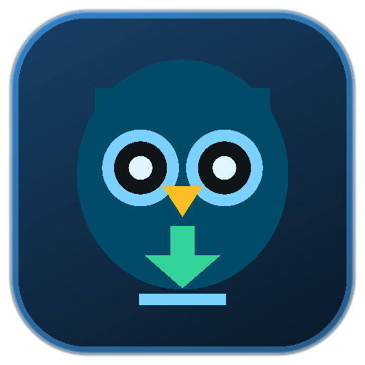

# 🦉 Owl Downloader (بومة التحميل)

<p align="center">
  
</p>

<p align="center">
  <b>تطبيق أندرويد متكامل وخفيف الوزن لتنزيل مقاطع الفيديو، الصوتيات، والصور من مختلف منصات التواصل الاجتماعي بأعلى جودة وبدون إعلانات مزعجة.</b>
  <br>
  <i>A lightweight, high-performance Android media downloader & player supporting multiple social platforms with zero third-party dependencies.</i>
</p>

<p align="center">
  
  
  
  
</p>

---

## 📖 جدول المحتويات / Table of Contents
- [✨ المميزات الرئيسية (Features)](#-المميزات-الرئيسية-features)
- [🌐 المنصات المدعومة (Supported Platforms)](#-المنصات-المدعومة-supported-platforms)
- [🏗️ البنية البرمجية والتقنيات (Architecture)](#️-البنية-البرمجية-والتقنيات-architecture)
- [🚀 التحميل والتثبيت السريع (Direct Download)](#-التحميل-والتثبيت-السريع-direct-download)
- [🛠️ كيفية البناء من المصدر (Build from Source)](#️-كيفية-البناء-من-المصدر-build-from-source)
- [📁 هيكل المشروع (Project Structure)](#-هيكل-المشروع-project-structure)
- [📄 الترخيص (License)](#-الترخيص-license)

---

## ✨ المميزات الرئيسية (Features)

* **⚡ سرعة فائقة وخفة تامة:** تم بناء التطبيق بأقل اعتمادية ممكنة على المكتبات الخارجية، مما يجعل حجم التطبيق النهائي **أقل من 1 ميجابايت**!
* **🎨 واجهة مستخدم عصرية (Glassmorphism Dark UI):** تصميم داكن فخم مع تأثيرات بصرية جذابة، متجاوب بالكامل وسهل الاستخدام.
* **🎬 مشغل فيديو عائم (Floating Mini-Player):** إمكانية معاينة الفيديو داخل التطبيق عبر مشغل فيديو مدمج قبل أو بعد التنزيل.
* **🔄 مشاركة مباشرة عبر النظام (System Share Intent):** مشاركة أي رابط مباشرة من أي تطبيق (مثل إنستغرام أو تيك توك) إلى Owl لبدء التنزيل فوراً.
* **📤 مشاركة سلسة وآمنة:** مشاركة الوسائط المحملة إلى واتساب، تيليجرام، وتطبيقات المعرض بدون أي مشاكل أذونات بفضل `OwlFileProvider`.
* **📂 حفظ تلقائي في المعرض والتنزيلات:** حفظ الملفات داخل مجلد التنزيلات العام `Download/Owl` مع دعم كامل لسياسات الأمان الحديثة (Android 10+ Scoped Storage & MediaStore).
* **🗃️ قاعدة بيانات مدمجة:** تخزين محلي لجميع التحميلات السابقة عبر SQLite مع إمكانية إعادة التشغيل أو الحذف.

---

## 🌐 المنصات المدعومة (Supported Platforms)

| المنصة | نوع التنزيل المدعوم | الملاحظات |
| :--- | :--- | :--- |
| **YouTube** | فيديو (MP4) / صوت فقط (M4A/MP3) | عبر واجهة `InnerTube` المباشرة متعددة العملاء (Android/Web/VR) |
| **TikTok** | فيديو عالي الدقة بدون علامة مائية | استخراج تلقائي مباشر بدون شعار تيك توك |
| **Instagram** | ريلز (Reels)، منشورات (Posts) | دعم استخراج الفيديو والصور العامة |
| **X (Twitter)** | فيديو وصور التغريدات | استخراج مباشر لأعلى دقة متوفرة |
| **Facebook** | ريلز ومقاطع الفيديو العامة | فك روابط الفيديو العامة السريعة |
| **Vimeo & Dailymotion** | مقاطع فيديو متنوعة | استخراج تدفق الوسائط الأصلي |
| **روابط وسائط مباشرة** | MP4, WEBM, M4A, MP3, JPG, PNG, WEBP | تنزيل مباشر وفوري مع شريط تقدم |

---

## 🏗️ البنية البرمجية والتقنيات (Architecture)

1. **الواجهة الأمامية (Frontend):**
   * كود نظيف مكتوب بـ HTML5 / Modern CSS / Vanilla JavaScript بدون أي أطر عمل ثقيلة.
   * مدمجة داخل تطبيق الأندرويد باستخدام Android `WebView` المحسن.
2. **الواجهة الخلفية للتطبيق (Android Native Backend):**
   * لغة **Kotlin** مع `JavascriptInterface` للربط التفاعلي بين الواجهة ومحرك النظام.
   * محرك استخراج روابط (Custom Stream Extractors) بدون الاعتماد على أدوات بايثون خارجية مثل yt-dlp على الجهاز، مما يضمن خفة الحجم وسرعة الاستجابة.
   * مزود محتوى مخصص `OwlFileProvider` لضمان التوافق مع أنظمة أندرويد من 7.0 حتى 15.0 دون مواجهة استثناء `FileUriExposedException`.
   * تخزين محلي منظم باستخدام `OwlDatabaseHelper` المبني على SQLite.

---

## 🚀 التحميل والتثبيت السريع (Direct Download)

يمكنك تجربة وتثبيت التطبيق مباشرة على هاتفك الأندرويد عبر تنزيل ملف الـ APK الجاهز من هذا المستودع:
* 📥 [تحميل owl.apk مباشرة](owl.apk)

> **ملاحظة:** يتطلب التثبيت تفعيل خيار "تثبيت التطبيقات من مصادر غير معروفة" (Install from Unknown Sources) في إعدادات جهازك.

---

## 🛠️ كيفية البناء من المصدر (Build from Source)

تم تزويد المشروع بمسار بناء فائق السرعة عبر سكريبت PowerShell مخصص يتجاوز بطء Gradle ويبني التطبيق في بضع ثوانٍ:

### الطريقة الأولى: عبر سكريبت البناء السريع (موصى بها)
1. تأكد من توفر **Android SDK** و **Java JDK / Android Studio JBR**.
2. افتح PowerShell في مجلد المشروع ونفّذ:
```powershell
cd owl-android
.\build_owl_apk.ps1
```
يقوم هذا السكريبت تلقائياً بـ:
* تصريف الموارد بـ `aapt2`.
* تصريف كود Kotlin و R.java بـ `kotlinc`.
* تحويل البايت كود إلى دكس بواسطة `d8`.
* ضمج وترتيب الحزم بـ `zipalign`.
* توقيع الـ APK النهائي بشهادات v1/v2/v3 وتوليد `owl.apk`.

### الطريقة الثانية: عبر Gradle
يمكنك أيضاً فتح المشروع في **Android Studio** وبنائه كأي تطبيق أندرويد اعتيادي:
```bash
./gradlew assembleRelease
```

---

## 📁 هيكل المشروع (Project Structure)

```text
seal/
├── owl.apk                         # تطبيق الأندرويد النهائي الجاهز للتثبيت
├── owl_apkpure_icon_512.png        # شعار التطبيق عالي الدقة (512x512)
├── README.md                       # التوثيق والشرح الكامل للمشروع
├── LICENSE                         # ترخيص البرنامج (MIT)
└── owl-android/                    # كود المصدر الكامل للمشروع
    ├── build_owl_apk.ps1           # سكريبت البناء فائق السرعة
    ├── owl-release.jks             # مفتاح التوقيع
    └── app/
        └── src/main/
            ├── AndroidManifest.xml # إعدادات التطبيق والأذونات
            ├── assets/
            │   └── index.html      # واجهة المستخدم وتجربة الاستخدام (WebView UI)
            ├── java/com/owl/downloader/
            │   ├── MainActivity.kt # محرك التنزيل واستخراج الوسائط والربط بالنظام
            │   └── database/
            │       └── OwlDatabase.kt # قاعدة بيانات SQLite المحلية
            └── res/                # الأيقونات والموارد الرسومية
```

---

## 📄 الترخيص (License)
هذا المشروع مرخص تحت رخصة [MIT License](LICENSE).
يحق لك استخدامه وتعديله وتطويره بحرية.
